# A tour of `make menuconfig`

This is a screen-by-screen walk through the configuration menu from
[Step 45](45-menuconfig-openzynq.md). Step 45 explains how the menu is built
and what the generator does with your answers. This page shows what you see
when you run it, and which keys do what.

```
make menuconfig                              # edit .config
make defconfig DEFCONFIG=configs/oz_mc_defconfig   # or start from a preset
```

The menu is [Kconfiglib](https://github.com/ulfalizer/Kconfiglib)'s
`menuconfig`, vendored in `tools/kconfig/`, so it needs only Python 3. It
reads `Kconfig` at the top of the repository and writes `.config`.

## The top level

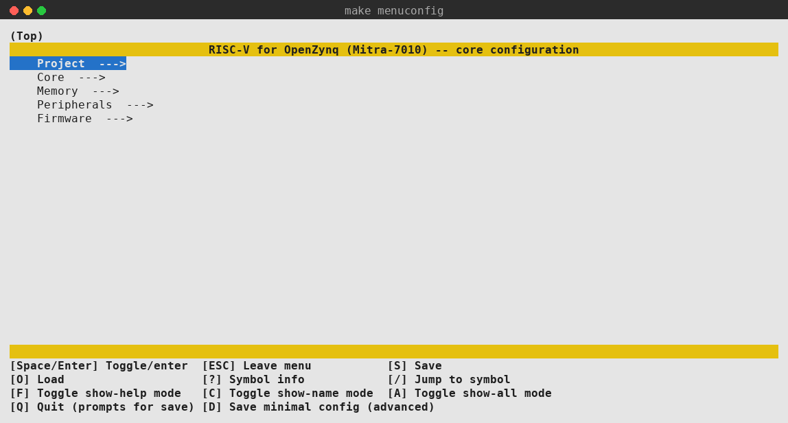

Five menus, in the order you would decide things: the project and how the
core talks to the outside world, the core itself, its memory, its
peripherals, and the program it runs.

The key reference is always at the bottom of the screen. The ones you will
use most:

| Key | Does |
|---|---|
| ↑ ↓, Enter / → | move, open a menu or toggle an entry |
| Space | toggle `[*]` / `[ ]`, or pick a `( )` choice |
| Esc / ← | back out of a menu or dialog |
| `?` | everything about the selected entry (help, dependencies, where it is defined) |
| `/` | search for an option by name or prompt |
| `C` | show the `CONFIG_` names next to the prompts |
| `F` | show the help text of the selected entry under the menu |
| `S` / `Q` | save / quit (asks whether to save) |

Entries come in four shapes: `--->` opens a submenu, `[*]` is a yes/no
option, `( )` / `(X)` is one choice out of several, and `(value)` is a number
or a string you type.

## Project

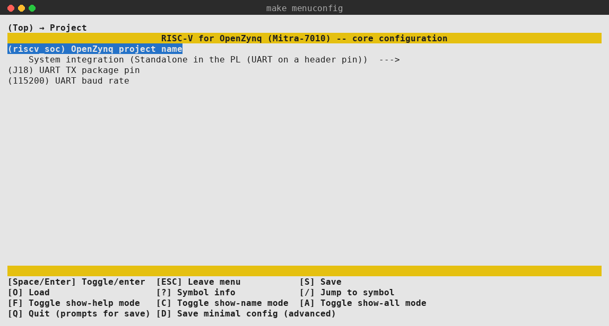

- **OpenZynq project name** — the directory the generator creates under
  OpenZynq's `projects/`.
- **System integration** — *standalone* (the core runs alone in the PL, its
  UART on an expansion-header pin) or *attached to the Cortex-A9* (the PS
  loads the program over AXI and relays the console to the on-board USB
  UART).
- **UART TX package pin** and **baud rate** — only shown for the standalone
  system. Pick *PS-attached* and both disappear, because the PS owns the
  console there.

## Core

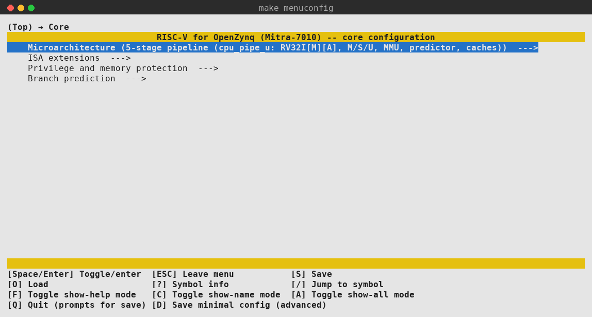

The first entry chooses the microarchitecture. Everything else in this menu
depends on that choice.

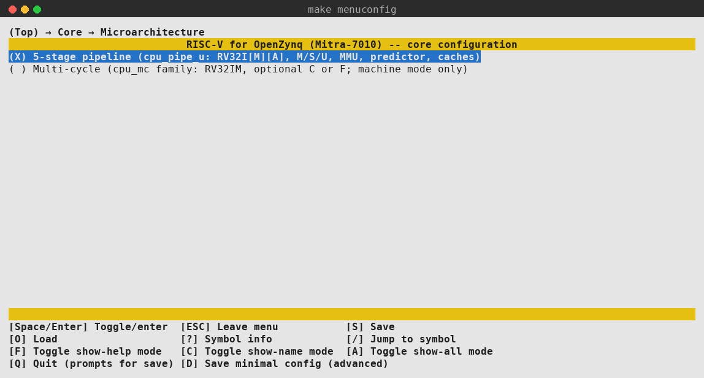

With the **5-stage pipeline** (`cpu_pipe_u`) you get three submenus:

| ISA extensions | Privilege and memory protection | Branch prediction |
|---|---|---|
| 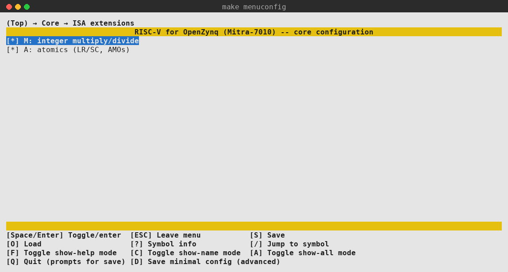 | 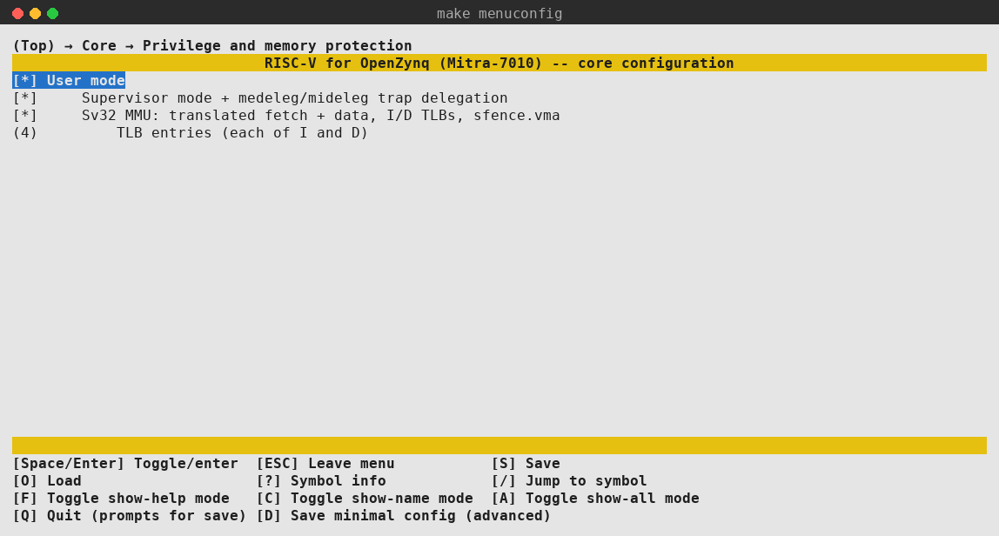 | 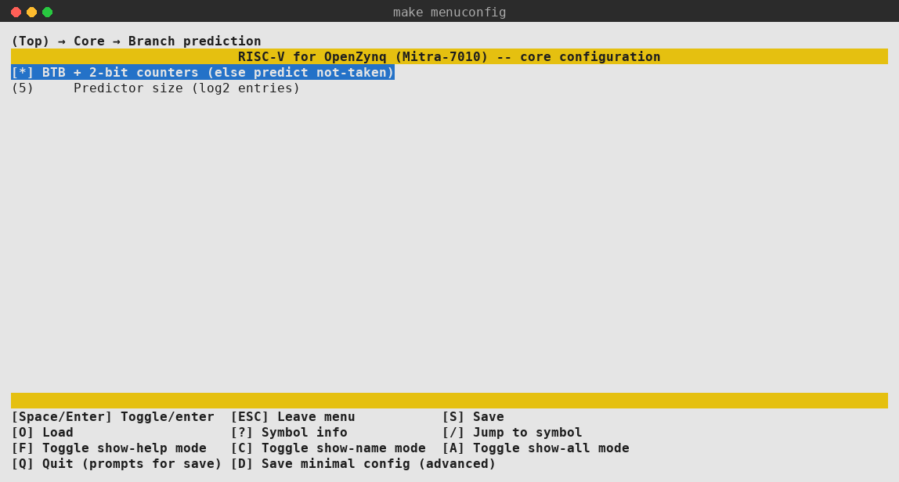 |

Indentation shows dependencies. *Supervisor mode* and the *MMU* are indented
under *User mode*, because they need it. Turn *User mode* off and they go
away. *TLB entries* is indented once more, under the MMU.

### Switching to the multi-cycle core

Pick **Multi-cycle** and the menu changes shape:

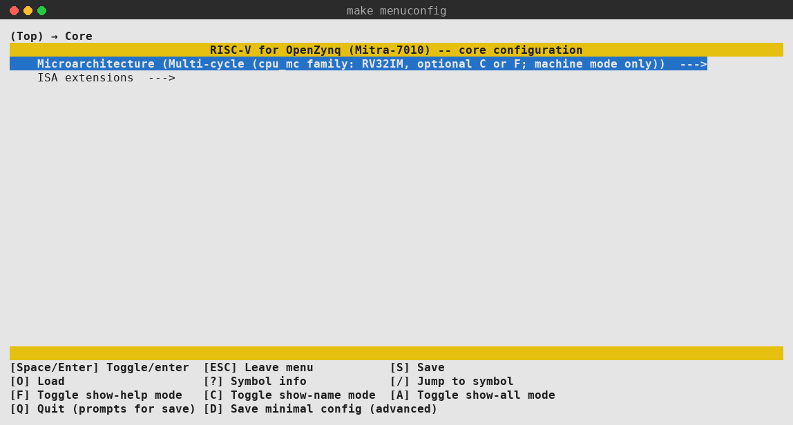

*Privilege and memory protection* and *Branch prediction* are gone. The
multi-cycle cores run in machine mode only and have no predictor, so the
menu does not offer them. *ISA extensions* now holds a different question:

| ISA extensions (multi-cycle) | Multi-cycle extension | After picking F |
|---|---|---|
| 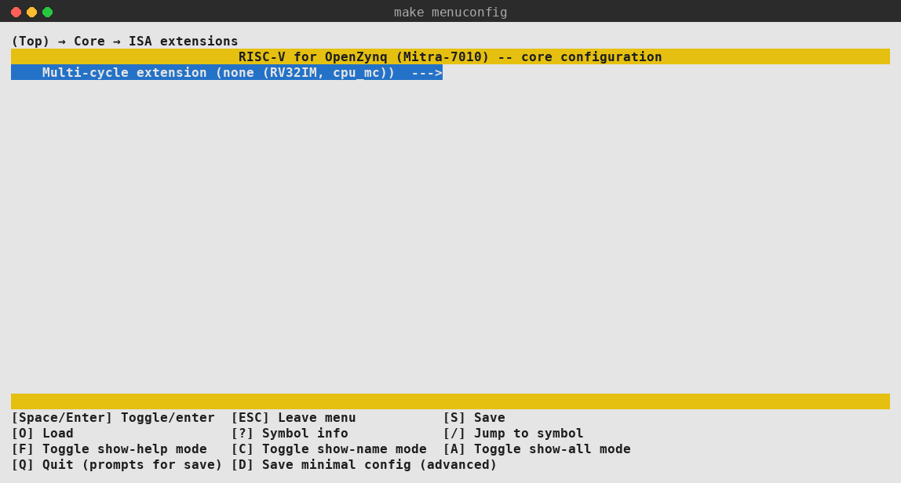 | 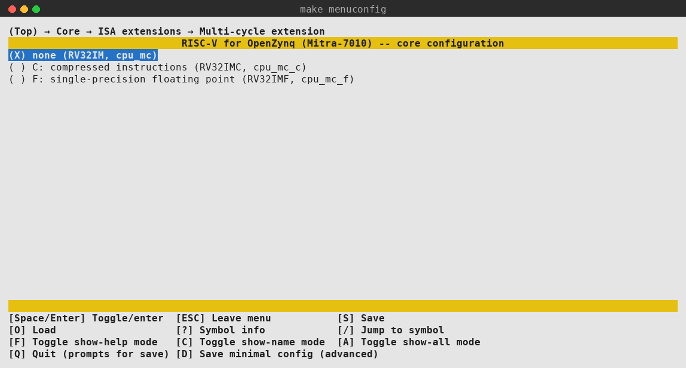 | 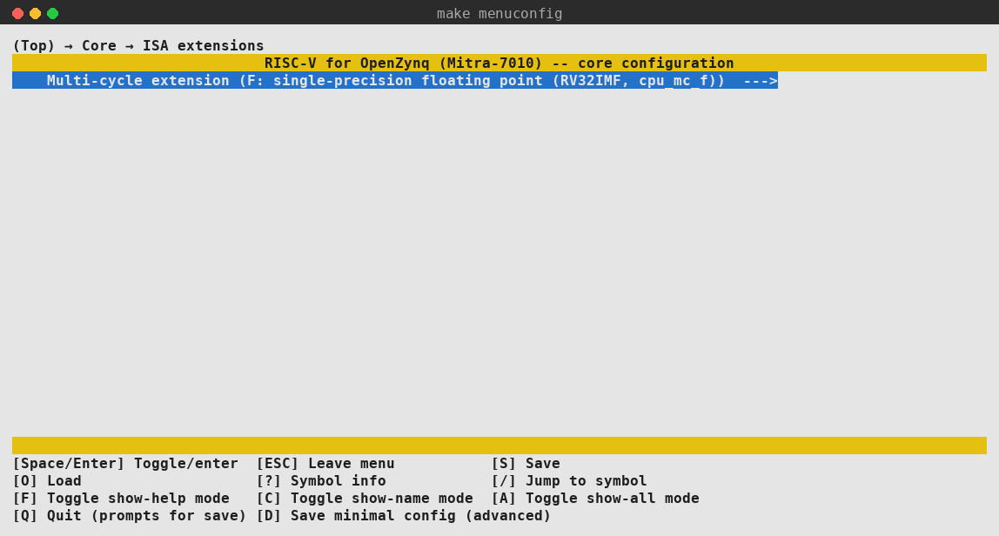 |

M is always present on these cores, so it is no longer a checkbox. Instead
you choose **one** of none, C (compressed, `cpu_mc_c`) or F
(single-precision float, `cpu_mc_f`). They are separate cores, so you get
one or the other.

This is the point of the menu: it only offers combinations of features that
exist on a single core. (Step 45, *The menu*, has the full list of what
lives where.)

## Memory

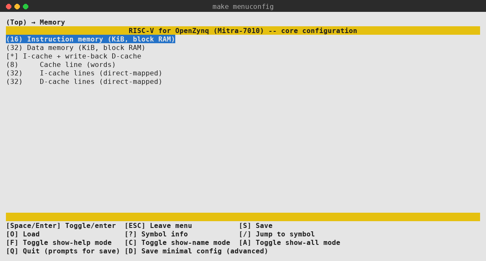

Block-RAM sizes for instruction and data memory, then the caches, which only
the pipeline has. On the multi-cycle core the same menu is just the two
sizes:

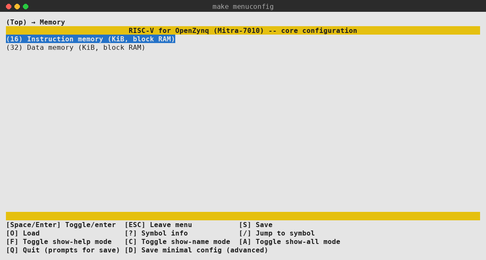

### Typing a value

Press Enter on a `(value)` entry to edit it. The dialog shows the allowed
range:

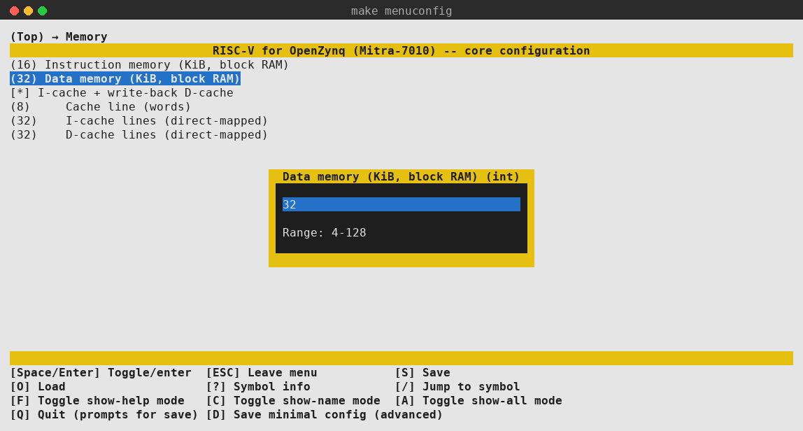

A value outside the range is refused. Fix it, or press Esc to keep the old
value:

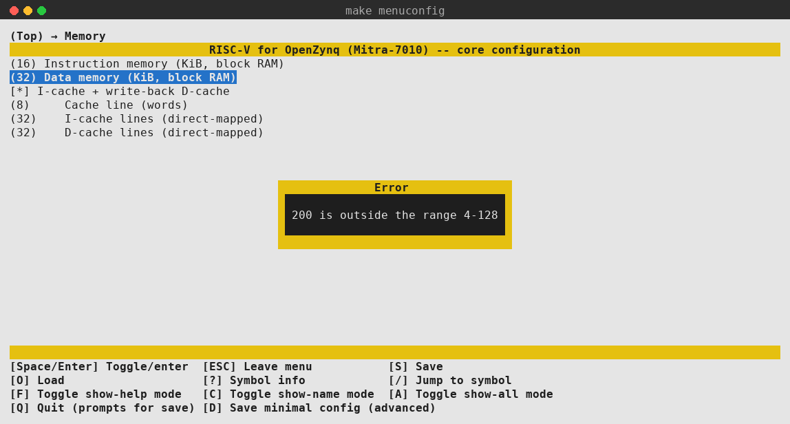

## Peripherals and Firmware

**Peripherals** has the machine timer and the GPIO block (the board's two
LEDs and two buttons). **Firmware** picks what is loaded into instruction
memory: the self-test that matches your configuration (the default, and what
the generated testbench runs), or your own `.hex` file.

## Finding out more about an option

### `?` — symbol information

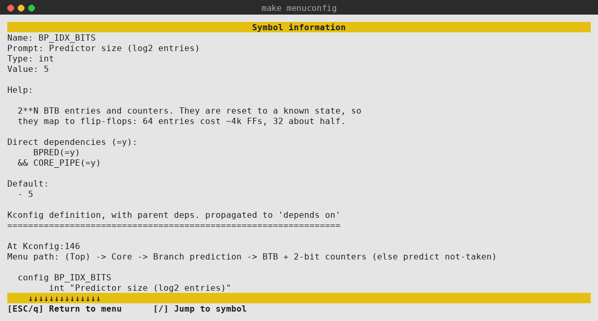

`?` on any entry shows its `CONFIG_` name, type, current value, help text,
what it depends on (with the current value of each dependency), its default,
and the file and line where it is defined. This is the quickest way to
answer "why can't I see option X?": its *Direct dependencies* line tells you
what has to be enabled first.

### `F` — help under the menu

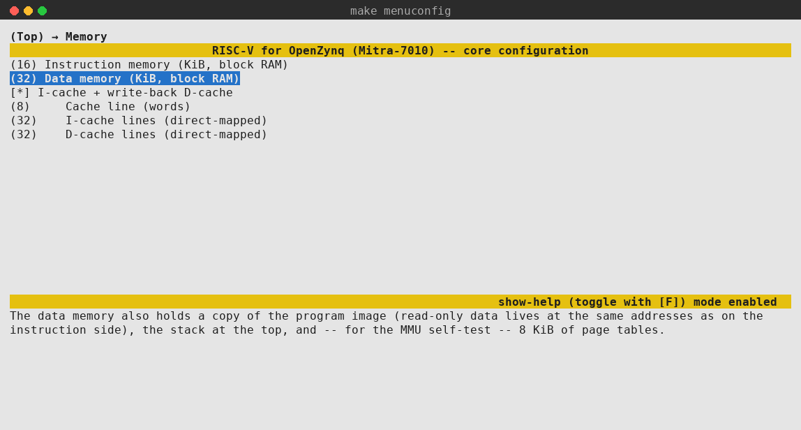

`F` keeps a help pane at the bottom that follows the cursor. Useful while
you scroll through a menu you don't know yet.

### `C` — show names

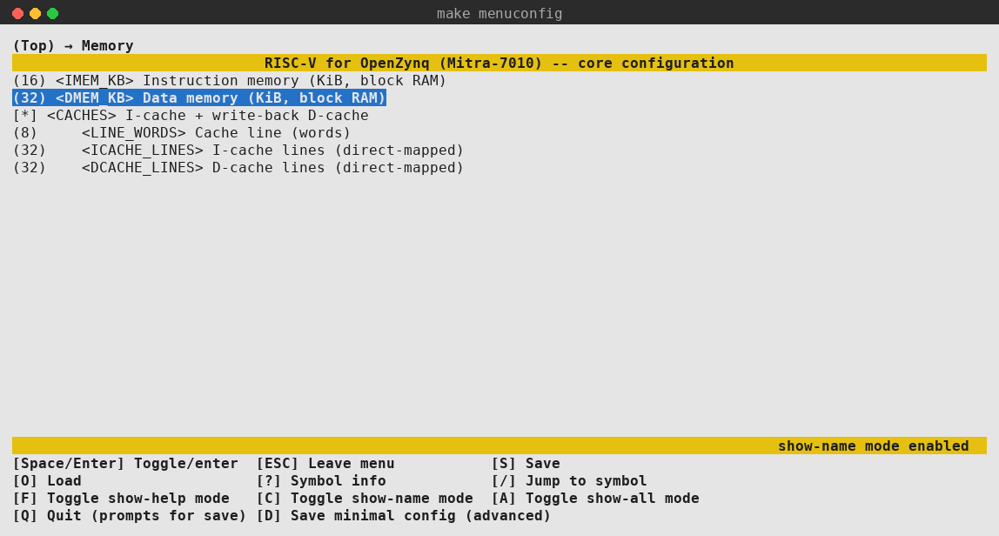

`C` puts each option's symbol name next to its prompt. These are the names
you will see in `.config` (with a `CONFIG_` prefix) and in the presets under
`configs/`.

### `/` — search

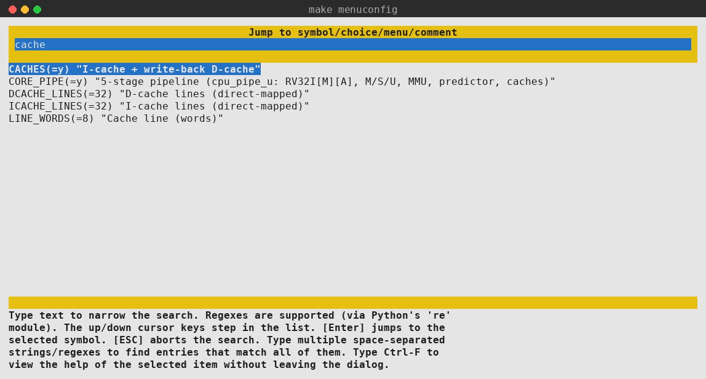

`/` searches names and prompts (Python regular expressions work). Enter
jumps straight to the selected entry, even if it is in a menu you are not
in.

## Saving

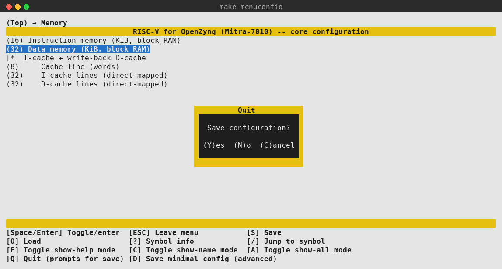

`Q` asks whether to save. *Yes* writes `.config` in the repository root;
`S` saves without leaving. The file is plain text:

```
CONFIG_PROJECT_NAME="riscv_soc"
CONFIG_SYS_STANDALONE=y
CONFIG_UART_TX_PIN="J18"
CONFIG_UART_BAUD=115200
CONFIG_CORE_PIPE=y
CONFIG_ISA_M=y
CONFIG_ISA_A=y
...
CONFIG_FW_SELFTEST=y
```

`D` (or `make savedefconfig`) writes the *minimal* form instead: only the
lines that differ from the defaults. That is how the presets in `configs/`
are stored, so they stay short. For example, `configs/oz_mc_f_ps_defconfig`:

```
CONFIG_PROJECT_NAME="riscv_mc_f_ps"
CONFIG_SYS_PS=y
CONFIG_CORE_MC=y
CONFIG_ISA_F=y
```

## Next

```
make rvgen                       # .config -> build/oz/projects/<name>/, simulated
make oz-export OZ=../OpenZynq    # copy it into an OpenZynq checkout
```

[Step 45](45-menuconfig-openzynq.md) covers what is generated, the presets,
and the synthesis results.

---

*The screenshots were taken by running `menuconfig` in an 112×28 terminal
inside tmux, starting from the default configuration.*
